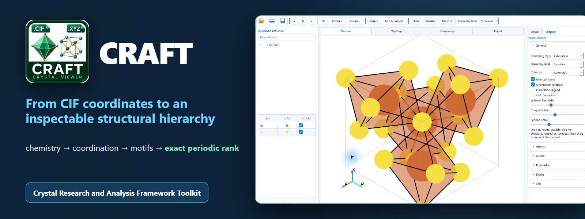

# CRAFT

**CRAFT — Crystal Research and Analysis Framework Toolkit** is a desktop program for viewing and analysing crystal structures from CIF files.

## Download

**[Download `CRAFT_Windows_1.1.2_Setup.exe` →](https://github.com/ABKuznetsov/CRAFT/releases/download/v1.1.2/CRAFT_Windows_1.1.2_Setup.exe)**

Run the installer as administrator. CRAFT is installed in `C:\Program Files\XRD Craft` and uses the shared `C:\ProgramData\Sci` environment for the scientific applications.

**[Open the interactive presentation and visual guide →](https://abkuznetsov.github.io/CRAFT/)**

## See more than atoms

CRAFT turns crystallographic data into an explorable structural map. It combines a responsive 3D viewer with chemistry-aware analysis, so you can move from atomic coordinates to bonds, coordination environments, structural units, motifs and periodic topology in one workspace.

The interface keeps the model visible at every step: select an atom or structural object, inspect its environment, change the representation and immediately see the result in the scene. Worked examples in the interactive presentation use the real CRAFT interface.

## What CRAFT can do

| Capability | What you get |
|---|---|
| Interactive structure viewer | Atoms, bonds, unit cells, coordination polyhedra, molecules and structural units in a controllable 3D scene. |
| Automatic structure analysis | Chemical context, coordination numbers, local geometry, connected components, rings and recurring motifs. |
| Periodic topology | Recognition of finite units, chains, layers and three-dimensional frameworks. |
| Multiple representations | Inorganic, molecular and reticular views of the same crystallographic model. |
| Structure comparison | Side-by-side inspection and explicit structural descriptors for comparing loaded structures. |
| Morphology and reporting | Crystal-form analysis, figures, tables and reusable analysis reports. |

## How it works

1. Open a structure or a saved project.
2. CRAFT reads the crystallographic model, identifies chemically meaningful neighbours and builds the appropriate structural representations.
3. Explore the hierarchy in 3D, inspect diagnostics, compare structures and export the results you need.

CRAFT keeps calculated graph properties separate from crystal-chemical interpretation. If the input coordination model is incomplete or ambiguous, the program shows the diagnostic instead of forcing a familiar structural label.

## Supported files

| Format | Files | Use |
|---|---|---|
| CRAFT project | `.craft` | Reopen a saved workspace with its structures, analysis settings and view state. |
| Crystallographic Information File | `.cif` | Load crystal structures and crystallographic metadata. |
| XRD Phase Finder project | `.xpff` | Open structures selected or saved in XRD Phase Finder. |
| SHELX | `.res`, `.ins` | Load refined or input crystal structures. |
| VASP | `.vasp`, `POSCAR`, `CONTCAR` | Load periodic structures from VASP calculations. |
| Protein Data Bank | `.pdb` | Load molecular and crystallographic coordinate models. |
| XYZ | `.xyz` | Load Cartesian atomic coordinates. |

## Run from source

Python 3.11 or 3.12 is required. Start CRAFT with `run_craft.bat`.

## License

GNU General Public License v3.0. See [LICENSE](LICENSE).

## Author

**Artem B. Kuznetsov**  
V. S. Sobolev Institute of Geology and Mineralogy, Siberian Branch of the Russian Academy of Sciences
