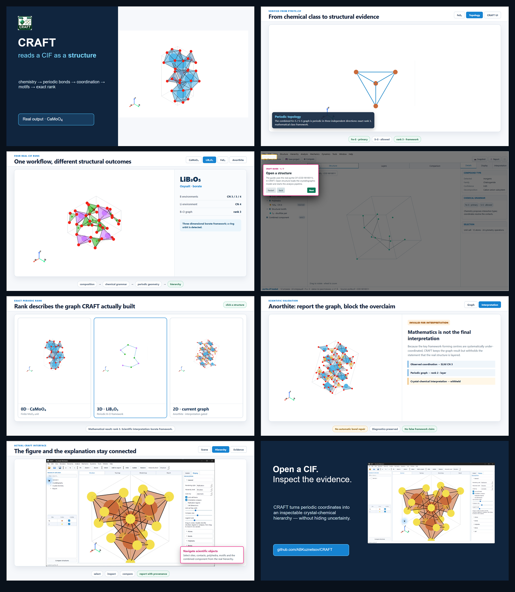

<p align="center">
  <a href="https://abkuznetsov.github.io/CRAFT/">
    
  </a>
</p>

<p align="center">
  <a href="https://abkuznetsov.github.io/CRAFT/"><strong>Interactive tour</strong></a>
  ·
  <a href="https://github.com/ABKuznetsov/CRAFT/releases/download/v1.1.1/CRAFT_Windows_1.1.1_Setup.exe"><strong>Download for Windows</strong></a>
  ·
  <a href="https://github.com/ABKuznetsov/CRAFT/releases/download/v1.1.1/CRAFT_macOS_1.1.1.pkg"><strong>Download for macOS</strong></a>
</p>

<p align="center">
  
  
  
  
</p>

## Direct downloads

| File | Download |
|---|---|
| CRAFT 1.1.1 · Windows 10/11 | [`CRAFT_Windows_1.1.1_Setup.exe`](https://github.com/ABKuznetsov/CRAFT/releases/download/v1.1.1/CRAFT_Windows_1.1.1_Setup.exe) · [SHA-256](https://github.com/ABKuznetsov/CRAFT/releases/download/v1.1.1/CRAFT_Windows_1.1.1_Setup.exe.sha256) |
| CRAFT 1.1.1 · macOS 13+ | [`CRAFT_macOS_1.1.1.pkg`](https://github.com/ABKuznetsov/CRAFT/releases/download/v1.1.1/CRAFT_macOS_1.1.1.pkg) · [SHA-256](https://github.com/ABKuznetsov/CRAFT/releases/download/v1.1.1/CRAFT_macOS_1.1.1.pkg.sha256) |
| Interactive presentation · standalone HTML | [`CRAFT-interactive-tour.html`](https://github.com/ABKuznetsov/CRAFT/raw/refs/heads/main/docs/index.html) |
| Editable presentation · SPICY SLIDES | [`CRAFT-interactive-tour.spicy`](https://github.com/ABKuznetsov/CRAFT/raw/refs/heads/main/docs/presentation/CRAFT-interactive-tour.spicy) |

# CRAFT

**CRAFT — Crystal Research and Analysis Framework Toolkit** is a desktop application for chemistry-aware visualization and structural analysis of crystallographic information files. It turns periodic coordinates into an inspectable hierarchy of bonds, coordination environments, polyhedra, structural units, motifs and periodic topology.

CRAFT is designed to answer three separate questions without mixing their evidence:

```text
CHEMISTRY          Which interactions are meaningful for this class of compound?
CRYSTALLOGRAPHY    Which candidate interactions are supported by periodic geometry?
CRYSTAL CHEMISTRY  What structural units, motifs and topology do those bonds form?
```

## Explore CRAFT

The [interactive browser tour](https://abkuznetsov.github.io/CRAFT/) uses real CRAFT views and verified runs for CaMoO₄, LiB₃O₅, FeS₂ and anorthite. It includes an interactive interface guide, coordination examples, exact-periodic-rank examples and the validation boundary between graph mathematics and crystal-chemical interpretation.

<p align="center">
  <a href="https://abkuznetsov.github.io/CRAFT/">
    
  </a>
</p>

## Highlights

- load CIF structures through the canonical [CRiStMa](https://pypi.org/project/cristma/) crystallographic model;
- classify chemical context before resolving coordination and structural connectivity;
- display atoms, bonds, coordination polyhedra, structural units and topology as linked scene layers;
- calculate exact periodic rank for finite, chain, layer and framework graphs;
- inspect rings, motifs, connected components and structure hierarchy;
- distinguish a mathematical graph result from a scientifically admissible interpretation;
- compare structures using explicit, versioned descriptors instead of a single opaque similarity score;
- prepare publication tables, figures and provenance-aware JSON/CSV/DOCX reports;
- use profile-aware views for inorganic, molecular and reticular structures;
- preserve source-CIF values, uncertainties, diagnostics and calculation provenance.

## Scientific examples

| Structure | What CRAFT resolves |
|---|---|
| **CaMoO₄** | MoO₄ coordination units: Mo CN 4, mean Mo–O 1.771 Å; finite MoO₄ graph, rank 0. |
| **LiB₃O₅** | BO₃/BO₄ environments, a periodic B–O framework with exact rank 3 and detected ring topology. |
| **FeS₂** | FeS₆ coordination, an S–S anion subsystem and a combined rank-3 framework. |
| **Anorthite** | The current graph is retained and measured, while systematic Si/Al under-coordination blocks an overconfident interpretation. |

The examples describe the current analysis pipeline and its diagnostics. CRAFT does not silently add bonds to force an expected structural classification.

## Download

### Windows 10/11

[Download `CRAFT_Windows_1.1.1_Setup.exe`](https://github.com/ABKuznetsov/CRAFT/releases/download/v1.1.1/CRAFT_Windows_1.1.1_Setup.exe)

The per-user installer creates or reuses the shared scientific Python environment under `%LocalAppData%\Sci`.

### macOS 13+

[Download `CRAFT_macOS_1.1.1.pkg`](https://github.com/ABKuznetsov/CRAFT/releases/download/v1.1.1/CRAFT_macOS_1.1.1.pkg)

Both packages have matching SHA-256 files on the [CRAFT 1.1.1 release page](https://github.com/ABKuznetsov/CRAFT/releases/tag/v1.1.1).

## Run from source

CRAFT requires Python 3.11 or 3.12.

```bash
git clone https://github.com/ABKuznetsov/CRAFT.git
cd CRAFT
```

Windows:

```text
run_craft.bat
```

macOS:

```bash
chmod +x run_craft.command toolkit/*.command
./run_craft.command
```

The launchers create or repair the shared `Sci` environment when required and then start the desktop application.

## Repository layout

```text
craft/                 application, analysis and presentation code
assets/                application icon
installer/             Windows installer definition
toolkit/               shared Sci-environment launch and setup scripts
scripts/               release-build scripts
docs/                  interactive GitHub Pages presentation and media
```

## Method boundary

CRAFT keeps four result types separate:

1. source crystallographic data and provenance;
2. chemistry-guided candidate interactions;
3. periodic geometric and graph results;
4. crystal-chemical interpretation.

If the coordination model is incomplete, CRAFT can retain coordination numbers, connected components and exact rank while withholding the final interpretation. This makes uncertainty visible instead of hiding it behind a familiar structural label.

## License

CRAFT is distributed under the [GNU General Public License v3.0](LICENSE).

## Citation

If CRAFT contributes to published research, cite this repository and record the application version, CRiStMa version and relevant analysis settings. A dedicated software-method publication is in preparation.

## Author

**Artem B. Kuznetsov**  
V. S. Sobolev Institute of Geology and Mineralogy, Siberian Branch of the Russian Academy of Sciences

